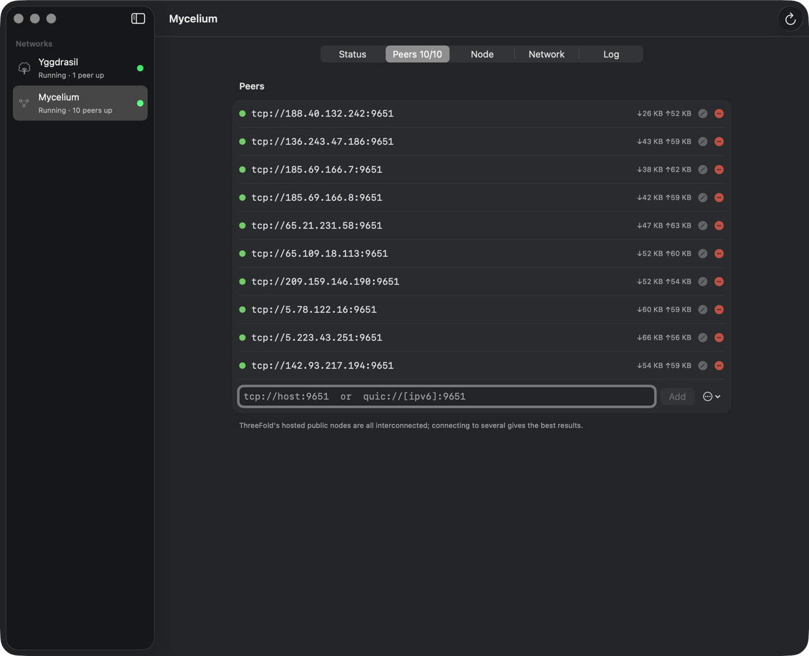

# Mac Mesh Profiler

A native macOS app to install, run and configure the
[Yggdrasil](https://yggdrasil-network.github.io) and
[Mycelium](https://github.com/threefoldtech/mycelium) mesh networks — each one
independently — without touching a terminal or a config file.

Both networks need the same chores on a Mac: install the daemon, run it as a
root service, and list the nodes (peers) it should connect to in a config file.
Mac Mesh Profiler does all of that from one window and a menu-bar item.



## Features

- **Install / update** each daemon from its official GitHub release, verified
  against GitHub's published sha256.
- **Start, stop, restart** each service, and choose whether it **starts at boot**.
- **Edit peers**: add, edit in place, remove, paste a whole list (every
  `tls://`, `tcp://`, `quic://` … address in the pasted text is picked up), or
  pick ThreeFold's public Mycelium nodes from a menu.
- **Live peer status** — green = connected, red = not connected, with traffic
  per peer. Read from each daemon's own API when available, otherwise from the
  open connections (`netstat`), so no password is needed.
- **Node info**: overlay IPv6 address and public key, with copy buttons.
- **Network tab**: every listening port (with what it is for) and every
  interface the daemon uses — TUN, LAN discovery, peering traffic, local APIs.
- **Log tab** with the daemon's log, following new lines.
- **Menu bar** item with status, start/stop and copy-address for both networks.

Each network has its own page with **Status · Peers · Node · Network · Log** tabs.

## Install

1. Download `MacMeshProfiler-<version>-macOS.zip` from
   [Releases](https://github.com/shatyrko/mac-mesh-profiler/releases)
   (universal: Apple Silicon and Intel, macOS 14 or later).
2. Unzip and move **Mac Mesh Profiler.app** to `/Applications`.
3. The app is ad-hoc signed, not notarized, so macOS blocks the first launch.
   Open it once, then **System Settings → Privacy & Security → Open Anyway** —
   or clear the quarantine flag:

   ```bash
   xattr -dr com.apple.quarantine "/Applications/Mac Mesh Profiler.app"
   ```

## Build from source

Only the Xcode Command Line Tools are needed:

```bash
scripts/build-app.sh             # → build/Mac Mesh Profiler.app (this Mac's architecture)
scripts/build-app.sh --install   # also copy it to /Applications
UNIVERSAL=1 scripts/build-app.sh --zip   # arm64 + x86_64 zip (needs full Xcode)
```

GitHub Actions builds every push to `main`; pushing a `v*` tag publishes a release.

## What it changes on your system

|                | Yggdrasil                                   | Mycelium                                               |
|----------------|---------------------------------------------|--------------------------------------------------------|
| Binary         | `/usr/local/bin/yggdrasil`, `yggdrasilctl`  | `/usr/local/bin/mycelium`                              |
| Installed from | official `.pkg` from yggdrasil-go releases  | `mycelium-<arch>-apple-darwin.tar.gz` from threefoldtech/mycelium releases |
| Config         | `/etc/yggdrasil.conf` (root-only, 0640)     | `/etc/mycelium/mycelium.toml` (0644)                   |
| Private key    | inside `yggdrasil.conf`                     | `/etc/mycelium/priv_key.bin` (root-only)               |
| Launch daemon  | `/Library/LaunchDaemons/yggdrasil.plist` (label `yggdrasil`, from the pkg) | `/Library/LaunchDaemons/tech.threefold.mycelium.plist` (created by the app) |
| Log            | `/tmp/yggdrasil.stdout.log`                 | `/var/log/mycelium.log` (rotated at 1 MB via newsyslog) |

### Privileges

Anything that touches root-owned files or launchd goes through the standard
macOS administrator prompt (`do shell script … with administrator privileges`).
Each action is a single script, passed base64-encoded, so nothing user-writable
is executed as root. Downloads are re-verified against their sha256 inside a
root-only temp directory before installing. Status, addresses, ports, logs and
the Mycelium config are read without a password.

### Yggdrasil configuration

`/etc/yggdrasil.conf` holds the node's private key and is readable only by root.

- **Load** (one password prompt) reads only `Peers`, `Listen`, `IfName`,
  `AdminListen`, the public key and the address — the private key never
  reaches the app.
- **Apply** merges just those keys into the current config, validates the
  result with `yggdrasil -normaliseconf`, keeps the previous file as
  `/etc/yggdrasil.conf.bak.<timestamp>` (newest 5), and restarts the service.
  After the first apply the file is plain JSON, so the comments written by
  `yggdrasil -genconf` are gone (the backup keeps them).
- **Local admin API** (off by default) sets `AdminListen` to
  `tcp://localhost:9001` for latency and per-peer errors. Any local program can
  then talk to the node's admin API.

### Mycelium configuration

Install writes a default `mycelium.toml` with ThreeFold's ten public nodes and a
free `utunN` interface (N ≥ 20, since low numbers are usually taken on macOS).
Settings the app doesn't edit are preserved when applying.

## Not handled

- Uninstalling either daemon.
- Yggdrasil `MulticastInterfaces`, `AllowedPublicKeys`, `InterfacePeers`,
  `NodeInfo` (kept as they are, not editable in the app).
- Mycelium private networks (`myceliumd-private`), topics, SOCKS proxy.

## Layout

```
Sources/MacMeshProfiler/
  MacMeshProfilerApp.swift   window + menu-bar scenes
  AppModel.swift             both services, 5-second status polling
  Core/                      shell, admin prompt, launchd, GitHub releases,
                             netstat/ifconfig inspection, peer matching
  Yggdrasil/                 config read/merge, admin API, install
  Mycelium/                  TOML read/write, HTTP API, public node list, install
  Views/                     SwiftUI views (tabs, peers, network, log)
Resources/Info.plist
scripts/build-app.sh         build, bundle, ad-hoc sign, zip
scripts/make-icon.swift      renders the app icon
.github/workflows/build.yml  CI build + release on v* tags
```

## License

[MIT](LICENSE) © 2026 Oleksiy Shatyrko
