# Mac Mesh Profiler

A native macOS app to install, run and configure the
[Yggdrasil](https://yggdrasil-network.github.io) and
[Mycelium](https://github.com/threefoldtech/mycelium) mesh networks — each one
independently — without touching a terminal or a config file.

Both networks need the same chores on a Mac: install the daemon, run it as a
root service, and list the nodes (peers) it should connect to in a config file.
Mac Mesh Profiler does all of that from one window and a menu-bar item.

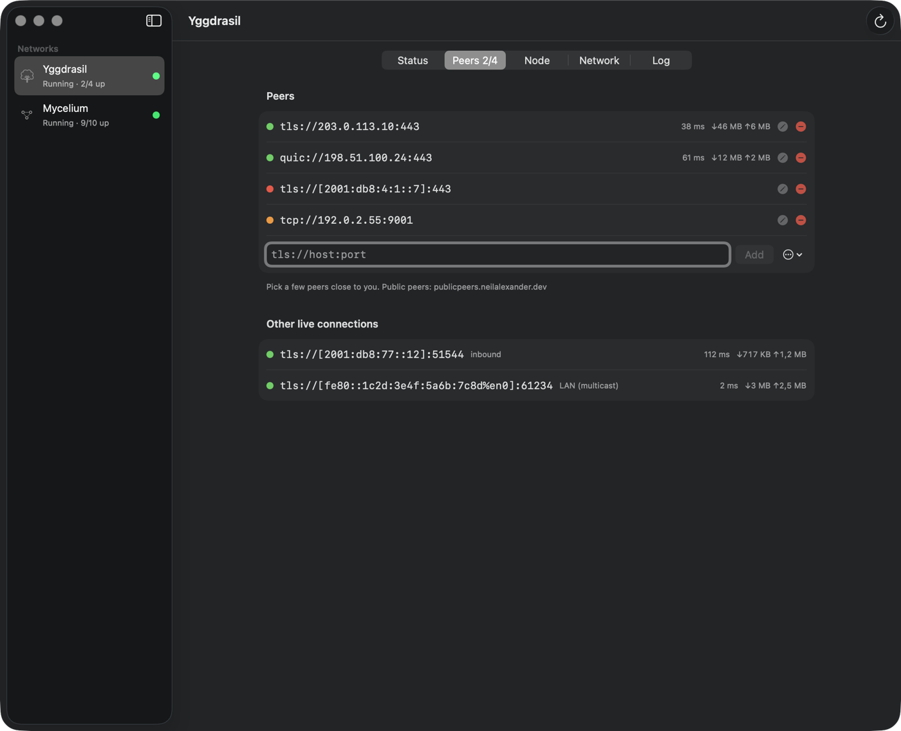

## Features

- **Install / update** each daemon from its official GitHub release, verified
  against GitHub's published sha256.
- **Start, stop, restart** each service, and choose whether it **starts at boot**.
- **Edit peers**: add, edit in place, remove, paste a whole list (every
  `tls://`, `tcp://`, `quic://` … address in the pasted text is picked up), or
  pick ThreeFold's public Mycelium nodes from a menu.
- **Live peer status** — green = connected, red = not connected, with traffic
  per peer. Read from each daemon's own API when available, otherwise from the
  open connections (`netstat`), so no password is needed.
- **Node info**: overlay IPv6 address and public key, with copy buttons.
- **Network tab**: every listening port (with what it is for) and every
  interface the daemon uses — TUN, LAN discovery, peering traffic, local APIs.
- **Log tab** with the daemon's log, following new lines.
- **Menu bar** item with status, start/stop and copy-address for both networks,
  plus connect/disconnect for system VPNs.
- **VPN section** for every VPN in System Settings (Proton VPN, WireGuard,
  company VPNs …): status, server, tunnel interface, routes and DNS while
  connected, connect/disconnect — and a **mesh check** that tells whether the VPN
  breaks Yggdrasil or Mycelium. See [VPNs](#vpns).
- **WireGuard section** for terminal WireGuard (`wg-quick`): install
  wireguard-tools via Homebrew, import `.conf` files (e.g. Proton VPN's WireGuard
  configs), start/stop tunnels, live handshakes and traffic, plus the same mesh
  check and routes view. See [WireGuard](#wireguard).

Each network has its own page with **Status · Peers · Node · Network · Log** tabs.

## Screenshots

| | |
|---|---|
| 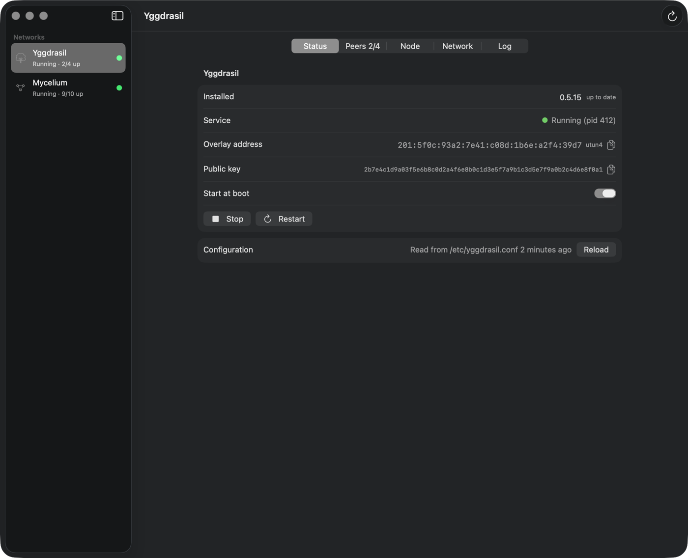 | 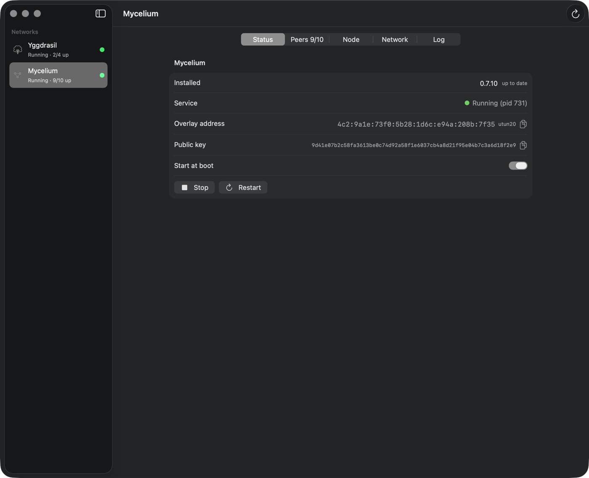 |
| **Status** — version and updates, service state, overlay address, public key, start at boot | Same for Mycelium, installed by the app from ThreeFold's release |
| 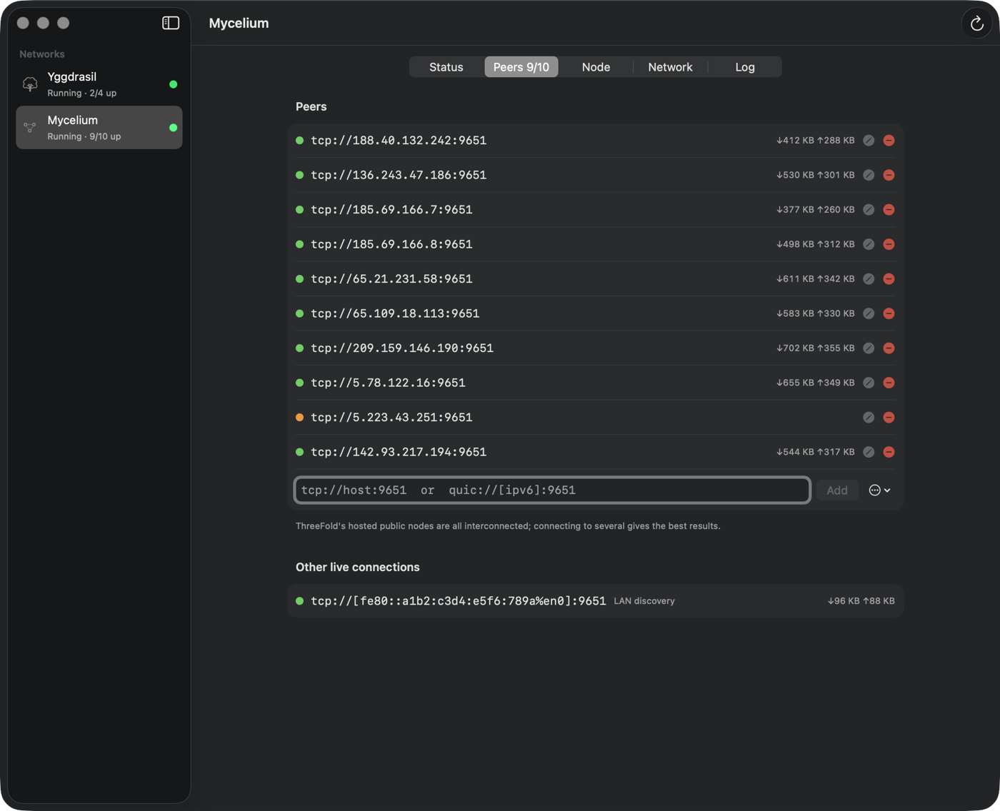 | 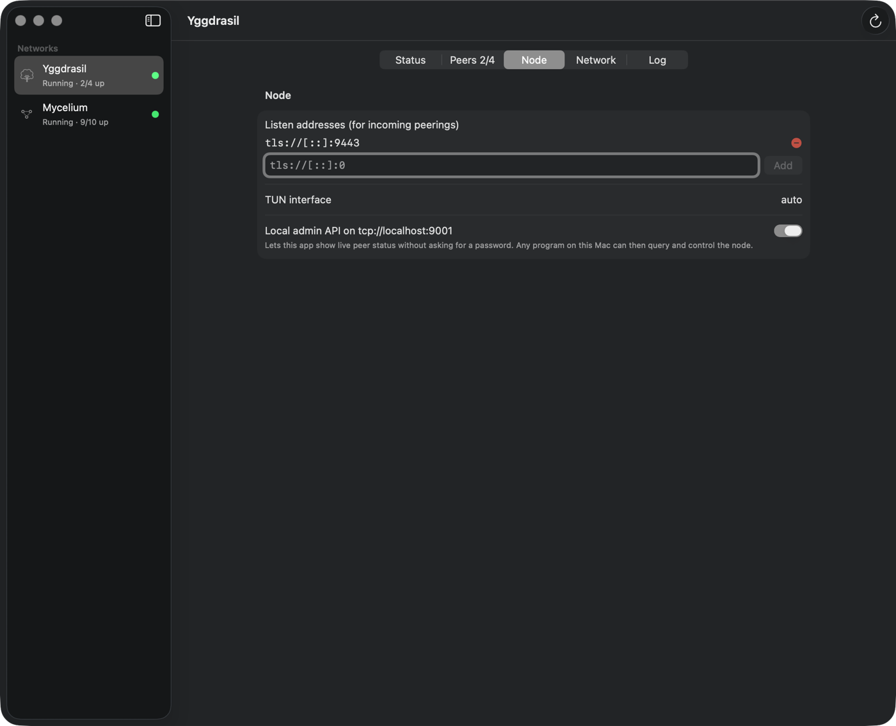 |
| **Peers** — green connected, orange connecting, red failed; traffic per peer; LAN and inbound connections | **Node** — listen addresses, TUN interface, optional local admin API |
| 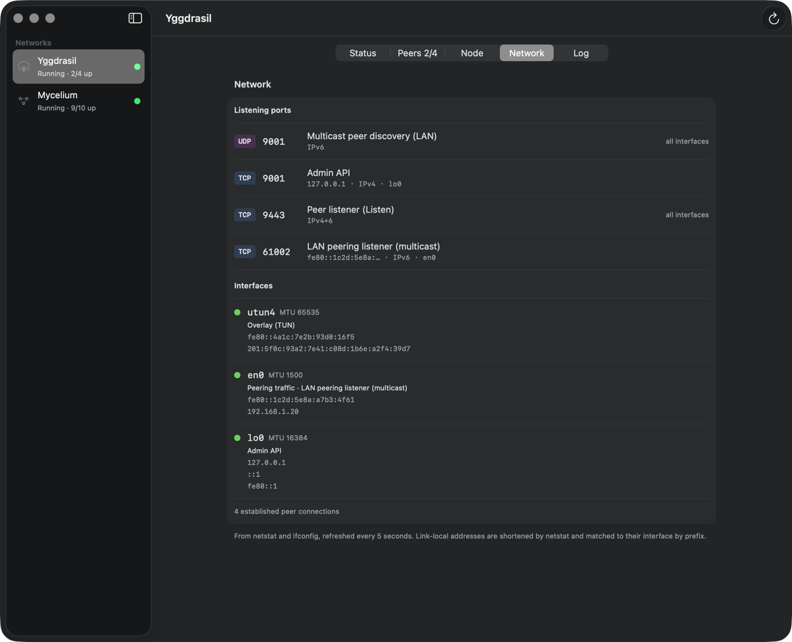 | 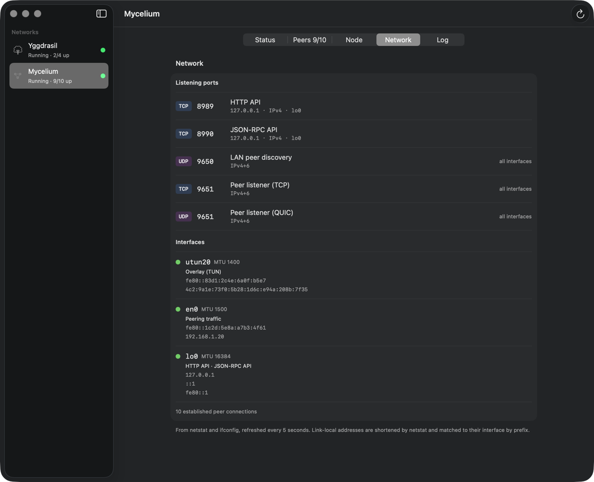 |
| **Network** — every listening port and what it is for | Interfaces in use: TUN, peering traffic, local APIs |

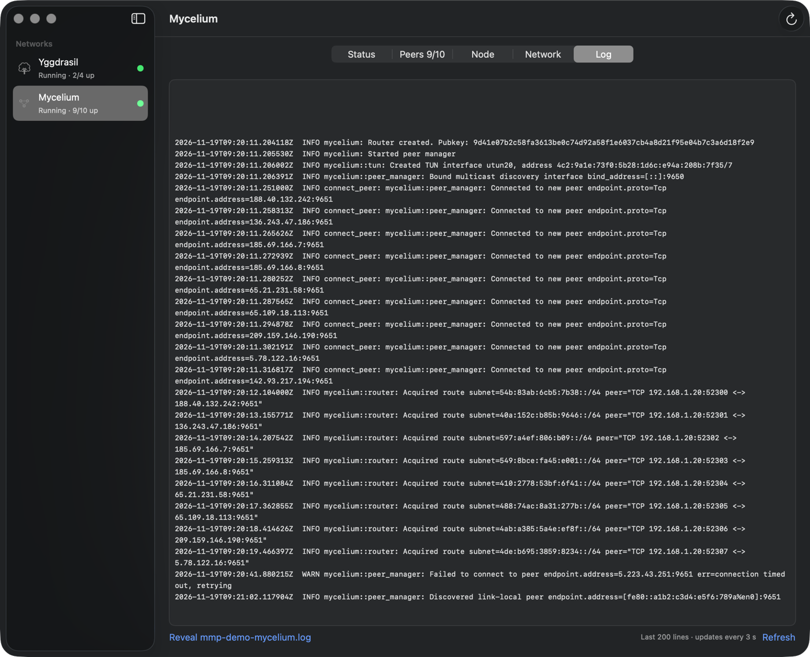

**Log** — the daemon's log, newest lines at the bottom.

| | |
|---|---|
| 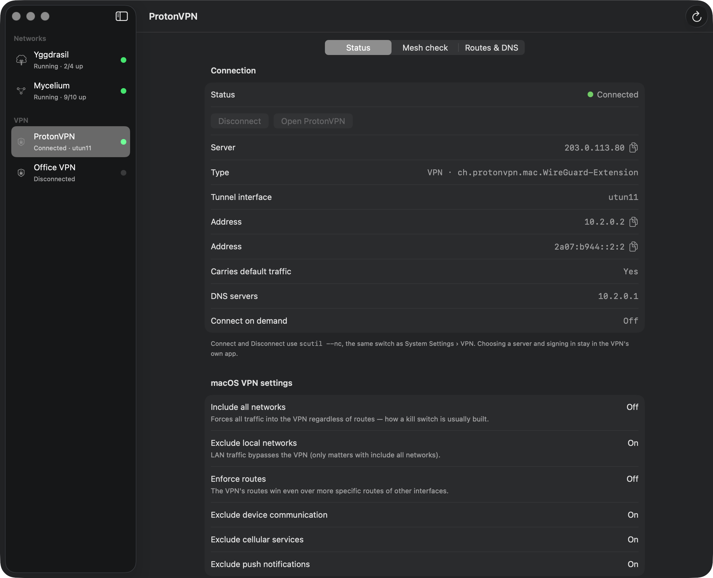 | 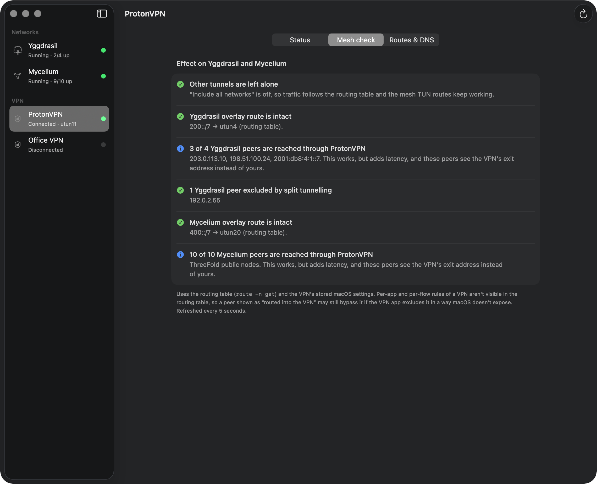 |
| **VPN status** — server, tunnel, macOS VPN flags such as *include all networks* | **Mesh check** — overlay routes, which peers go through the VPN, split-tunnel exclusions |

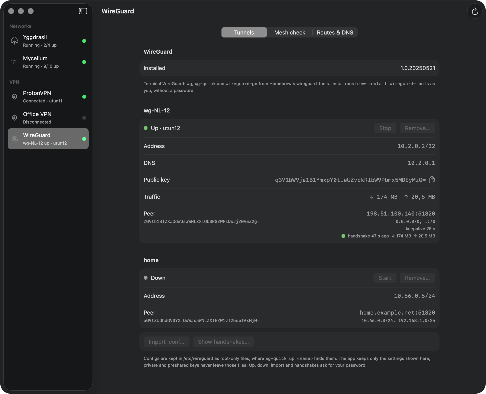

**WireGuard** — wg-quick tunnels with endpoint, allowed IPs, handshake and traffic.

<sub>Screenshots use the app's demo mode (sample data, documentation-range IPs).</sub>

## Install

1. Download `MacMeshProfiler-<version>-macOS.zip` from
   [Releases](https://github.com/shatyrko/mac-mesh-profiler/releases)
   (universal: Apple Silicon and Intel, macOS 14 or later).
2. Unzip and move **Mac Mesh Profiler.app** to `/Applications`.
3. The app is ad-hoc signed, not notarized, so macOS blocks the first launch.
   Open it once, then **System Settings → Privacy & Security → Open Anyway** —
   or clear the quarantine flag:

   ```bash
   xattr -dr com.apple.quarantine "/Applications/Mac Mesh Profiler.app"
   ```

## Build from source

Only the Xcode Command Line Tools are needed:

```bash
scripts/build-app.sh             # → build/Mac Mesh Profiler.app (this Mac's architecture)
scripts/build-app.sh --install   # also copy it to /Applications
UNIVERSAL=1 scripts/build-app.sh --zip   # arm64 + x86_64 zip (needs full Xcode)
```

GitHub Actions builds every push to `main`; pushing a `v*` tag publishes a release.

To see the app with sample data — no daemons, no system access, nothing
changed — launch it in demo mode (this is how the screenshots are made):

```bash
open "build/Mac Mesh Profiler.app" --args -demo YES
```

## What it changes on your system

|                | Yggdrasil                                   | Mycelium                                               |
|----------------|---------------------------------------------|--------------------------------------------------------|
| Binary         | `/usr/local/bin/yggdrasil`, `yggdrasilctl`  | `/usr/local/bin/mycelium`                              |
| Installed from | official `.pkg` from yggdrasil-go releases  | `mycelium-<arch>-apple-darwin.tar.gz` from threefoldtech/mycelium releases |
| Config         | `/etc/yggdrasil.conf` (root-only, 0640)     | `/etc/mycelium/mycelium.toml` (0644)                   |
| Private key    | inside `yggdrasil.conf`                     | `/etc/mycelium/priv_key.bin` (root-only)               |
| Launch daemon  | `/Library/LaunchDaemons/yggdrasil.plist` (label `yggdrasil`, from the pkg) | `/Library/LaunchDaemons/tech.threefold.mycelium.plist` (created by the app) |
| Log            | `/tmp/yggdrasil.stdout.log`                 | `/var/log/mycelium.log` (rotated at 1 MB via newsyslog) |

### Privileges

Anything that touches root-owned files or launchd goes through the standard
macOS administrator prompt (`do shell script … with administrator privileges`).
Each action is a single script, passed base64-encoded, so nothing user-writable
is executed as root. Downloads are re-verified against their sha256 inside a
root-only temp directory before installing. Status, addresses, ports, logs and
the Mycelium config are read without a password.

### Yggdrasil configuration

`/etc/yggdrasil.conf` holds the node's private key and is readable only by root.

- **Load** (one password prompt) reads only `Peers`, `Listen`, `IfName`,
  `AdminListen`, the public key and the address — the private key never
  reaches the app.
- **Apply** merges just those keys into the current config, validates the
  result with `yggdrasil -normaliseconf`, keeps the previous file as
  `/etc/yggdrasil.conf.bak.<timestamp>` (newest 5), and restarts the service.
  After the first apply the file is plain JSON, so the comments written by
  `yggdrasil -genconf` are gone (the backup keeps them).
- **Local admin API** (off by default) sets `AdminListen` to
  `tcp://localhost:9001` for latency and per-peer errors. Any local program can
  then talk to the node's admin API.

### Mycelium configuration

Install writes a default `mycelium.toml` with ThreeFold's ten public nodes and a
free `utunN` interface (N ≥ 20, since low numbers are usually taken on macOS).
Settings the app doesn't edit are preserved when applying.

## VPNs

A VPN isn't a mesh, but it shares the same routing table, so it can quietly
break one. The VPN section is **read-only** apart from connect/disconnect and
needs no password:

| What | Where it comes from |
|------|---------------------|
| List, state, server, on-demand | `scutil --nc list / show / status` |
| *Include all networks*, *exclude local networks*, *enforce routes* …, and companion configs such as Proton's split-tunnelling proxy | `/Library/Preferences/com.apple.networkextension.plist` (world-readable). Only these flags and vendor settings are read — never password or identity fields |
| Routes and DNS while connected | `netstat -rn`, `scutil --dns` |
| Connect / Disconnect | `scutil --nc start / stop`, the same switch as System Settings › VPN |

Some VPN apps switch macOS's *connect on demand* on while connected — Proton VPN
does. macOS then reconnects the VPN right after any stop, so for those the app
points you to the VPN's own app for disconnecting instead of offering a
Disconnect button that wouldn't stick.

The **mesh check** looks at:

- **Include all networks** — the usual way a kill switch is built. When on, all
  traffic is forced into the VPN regardless of routes, which most likely cuts off
  the Yggdrasil (`200::/7`) and Mycelium (`400::/7`) TUNs.
- **Overlay routes** — whether `200::/7` / `400::/7` still go to the mesh TUN.
- **Peering traffic** — which configured peers are reached through the VPN
  (`route -n get`). Public peers still work, with added latency; peers on
  private addresses most likely don't. Peers listed in Proton's split-tunnelling
  exclusions are counted as bypassing it.
- **Peer health** — a running mesh with no connected peers while the VPN is up.

The routing table doesn't show per-app or per-flow rules, so the check can't see
everything a VPN does. The VPN app's own settings (server choice, account, keys)
stay in its sandbox and Keychain and are not read.

## WireGuard

The WireGuard row is for **terminal WireGuard** — `wg`, `wg-quick` and
`wireguard-go` from Homebrew's `wireguard-tools`. (Tunnels of the WireGuard
App Store app are system VPNs and show up in the VPN list instead.)

| Action | How | Password |
|--------|-----|----------|
| Install / Update | `brew install` / `brew upgrade wireguard-tools` (adds `wireguard-go` and bash 5); the newest version comes from `brew info` | no |
| Import `.conf` | staged in the app's private temp folder (root can't read Documents/Desktop/Downloads for the app), then copied to `/etc/wireguard/<name>.conf`, root-only `600`; the directory is kept `755` so tunnel names can be listed | yes |
| Start / Stop | `wg-quick up` / `down <name>` | yes |
| Up or down, interface, traffic | the tunnel's address on a `utun` interface (`ifconfig`), counters from `netstat -I` | no |
| Handshakes, per-peer traffic | `wg show all dump`, with the key columns dropped before they reach the app | yes |
| Load details | the configs in `/etc/wireguard` without their `PrivateKey`/`PresharedKey` lines; the public key is derived with `wg pubkey` | yes |

The app keeps addresses, DNS, endpoints and allowed IPs of each tunnel in its
preferences; private and preshared keys stay in the root-only files. A tunnel
name is the file name (max 15 characters). `PostUp`/`PreDown` hooks are shown,
since `wg-quick` runs them as root.

Don't run the same config on two machines at once: WireGuard identifies a
client by its key, so the server keeps switching between them and both tunnels
break. Create a separate config (key) per device.

Proton VPN's app and its WireGuard configs both use `10.2.0.2`. Interfaces that
belong to a system VPN are skipped when deciding which tunnel is up, so running
both at once doesn't confuse the two.

## Not handled

- Uninstalling either daemon.
- Yggdrasil `MulticastInterfaces`, `AllowedPublicKeys`, `InterfacePeers`,
  `NodeInfo` (kept as they are, not editable in the app).
- Mycelium private networks (`myceliumd-private`), topics, SOCKS proxy.
- Changing a VPN's settings or choosing its server — that stays in the VPN's app.

## Layout

```
Sources/MacMeshProfiler/
  MacMeshProfilerApp.swift   window + menu-bar scenes
  AppModel.swift             both services + VPNs, 5-second status polling
  Core/                      shell, admin prompt, launchd, GitHub releases,
                             netstat/ifconfig inspection, peer matching,
                             system VPN reader, VPN mesh check
  Yggdrasil/                 config read/merge, admin API, install
  Mycelium/                  TOML read/write, HTTP API, public node list, install
  VPN/                       system VPN model (status, connect/disconnect)
  WireGuard/                 wg-quick configs, root scripts, tunnel model
  Views/                     SwiftUI views (tabs, peers, network, log)
Resources/Info.plist
scripts/build-app.sh         build, bundle, ad-hoc sign, zip
scripts/make-icon.swift      renders the app icon
.github/workflows/build.yml  CI build + release on v* tags
```

## License

[MIT](LICENSE) © 2026 Oleksiy Shatyrko
